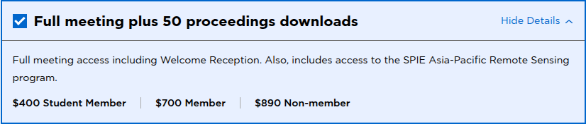
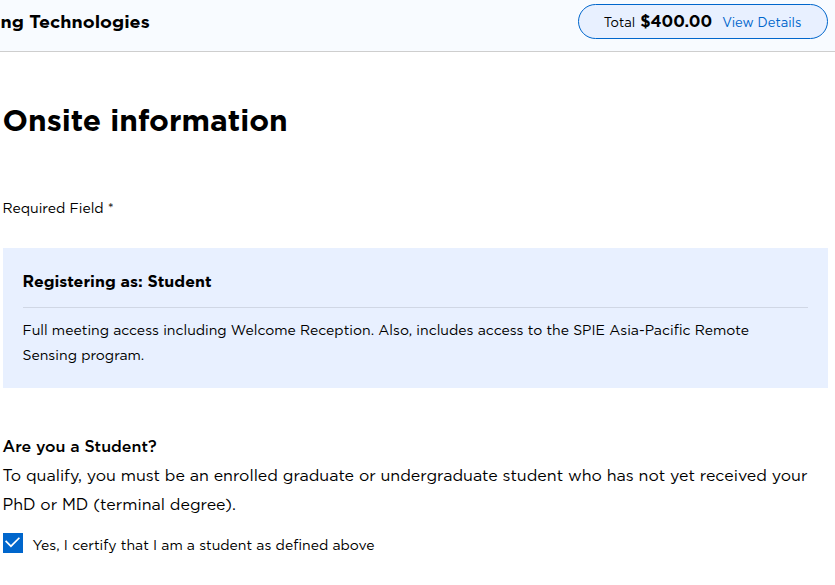

# SPIE student rate missing? Check the student box in Onsite Info

I had already paid for SPIE Student Membership, but registration for **SPIE Future Sensing Technologies 2026** still showed **US$700**. The same form advertised **US$400 for Student Members**. I thought my membership had not been recognized.

The membership was fine. The missing step was a separate checkbox under **Onsite Info → Are you a Student?** Selecting it changed the displayed total to **US$400**.

These are the prices I saw on **14 October 2026**, not a price list for every SPIE conference. The screenshots below show only the relevant form sections; account and payment details are excluded.

## What I checked first

The membership receipt showed **Student — 1 Year**, paid in full for **US$20**. In **My Account → Membership Status**, the membership type was already **Student Member**, with an expiry date after the conference.

Buying another membership would not have fixed this. The conference form needed its own student declaration.

*The published options in the registration form on 14 October 2026.*

## The steps that applied the student rate

1. Sign in with the **same SPIE account used to buy Student Membership**.
2. Open the conference registration and choose full-meeting access.
3. Complete **Your Info**, then open **Onsite Info**.
4. Under **Are you a Student?**, select **“Yes, I certify that I am a student as defined above.”** The form defines an eligible student as an enrolled undergraduate or graduate student who has not yet received a PhD or MD (terminal degree).
5. Enter your actual **projected graduation month and year**.
6. Check the displayed total and the final review before paying. In this case, the total changed immediately from **US$700 to US$400**.

*The checked student declaration and the resulting US$400 total. Selecting the box does not complete payment.*

## What about “Non-author attendee”?

That label was part of my initial confusion, but I could not reproduce it in the signed-in check. Before selecting the student box, the form recognized me as **Speaker/Author**. After selecting it, the displayed registration category became **Student**.

Three things are worth checking separately:

- **Active Student Membership:** My Account → Membership Status.
- **Student registration rate:** Onsite Info → student declaration, then the total.
- **Accepted presentation:** the account's submission tasks and presentation details.

If your form still says **Non-author attendee**, check that the accepted paper is visible in that same account. If the paper is missing, or the student price still does not apply, contact **customerservice@spie.org** with the relevant details privately. The unchecked student box explained my pricing issue; it does not establish why another account might have an author-status mismatch.

## Official links

- [SPIE account](https://spie.org/account/dashboard)
- [FST registration information and current rates](https://spie.org/conferences-and-exhibitions/future-sensing-technologies/attend/registration)
- [FST 2026 registration](https://spie.org/FST26/registration)
- [SPIE membership](https://spie.org/membership)

For this registration, the useful check was simple: **active Student Membership plus the student declaration in Onsite Info**. The US$400 total was visible before completing checkout.

[Read this guide on blog.lazying.art](https://blog.lazying.art/?p=3909).
